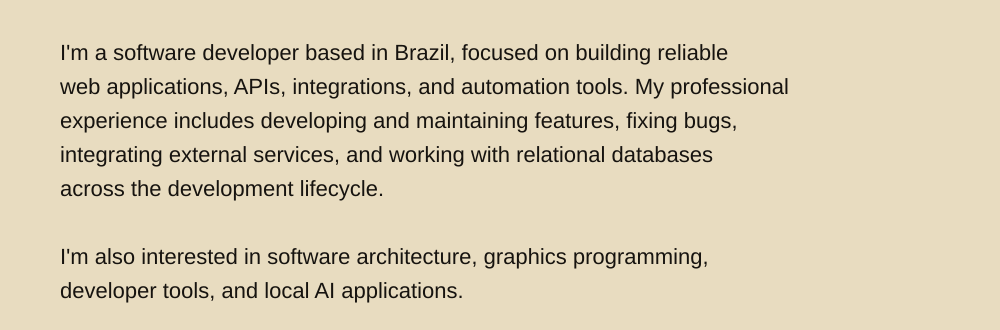
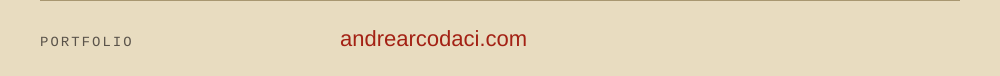
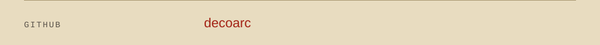
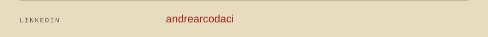

<picture>
  <source media="(prefers-color-scheme: dark)" srcset="assets/banner-dark.svg">
  <source media="(prefers-color-scheme: light)" srcset="assets/banner-light.svg">
  
</picture>

 

<picture>
  <source media="(prefers-color-scheme: dark)" srcset="assets/about-dark.svg">
  <source media="(prefers-color-scheme: light)" srcset="assets/about-light.svg">
  
</picture>

## 01 · Tech Stack

<picture>
  <source media="(prefers-color-scheme: dark)" srcset="assets/stack-dark.svg">
  <source media="(prefers-color-scheme: light)" srcset="assets/stack-light.svg">
  
</picture>

## 02 · Connect

<a href="https://andrearcodaci.com/">
  <picture>
    <source media="(prefers-color-scheme: dark)" srcset="assets/connect-1-dark.svg">
    <source media="(prefers-color-scheme: light)" srcset="assets/connect-1-light.svg">
    
  </picture>
</a>

<a href="https://github.com/decoarc">
  <picture>
    <source media="(prefers-color-scheme: dark)" srcset="assets/connect-2-dark.svg">
    <source media="(prefers-color-scheme: light)" srcset="assets/connect-2-light.svg">
    
  </picture>
</a>

<a href="https://www.linkedin.com/in/andrearcodaci/">
  <picture>
    <source media="(prefers-color-scheme: dark)" srcset="assets/connect-3-dark.svg">
    <source media="(prefers-color-scheme: light)" srcset="assets/connect-3-light.svg">
    
  </picture>
</a>
