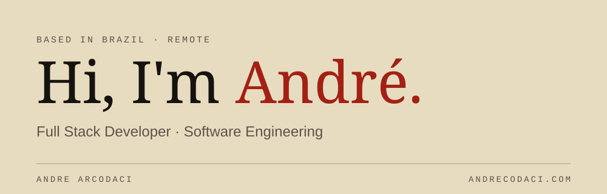
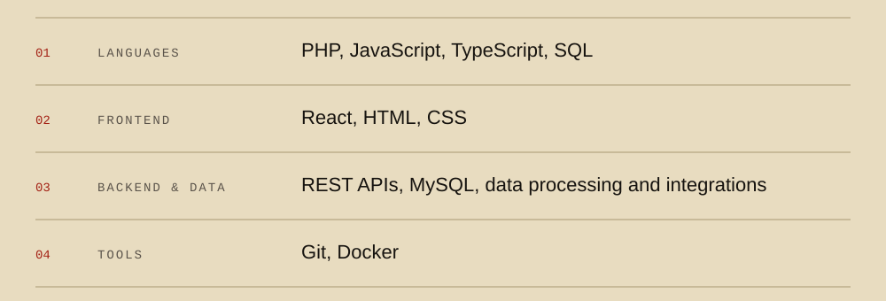

<picture>
  <source media="(prefers-color-scheme: dark)" srcset="assets/banner-dark.svg">
  <source media="(prefers-color-scheme: light)" srcset="assets/banner-light.svg">
  
</picture>

 

I'm a software developer based in Brazil, focused on building reliable web applications, APIs, integrations, and automation tools. My professional experience includes developing and maintaining features, fixing bugs, integrating external services, and working with relational databases across the development lifecycle.

I'm also interested in software architecture, graphics programming, developer tools, and local AI applications.

## 01 · Tech Stack

<picture>
  <source media="(prefers-color-scheme: dark)" srcset="assets/stack-dark.svg">
  <source media="(prefers-color-scheme: light)" srcset="assets/stack-light.svg">
  
</picture>

## 02 · Currently Exploring

- Full Stack application architecture
- Modern frontend engineering and UX
- Desktop applications and graphics programming
- Local AI and developer tools

## 03 · Connect

- Portfolio: [andrearcodaci.com](https://andrearcodaci.com/)
- GitHub: [decoarc](https://github.com/decoarc)
- LinkedIn: [andrearcodaci](https://www.linkedin.com/in/andrearcodaci/)
- Email: [andre.arcodaci@gmail.com](mailto:andre.arcodaci@gmail.com)
